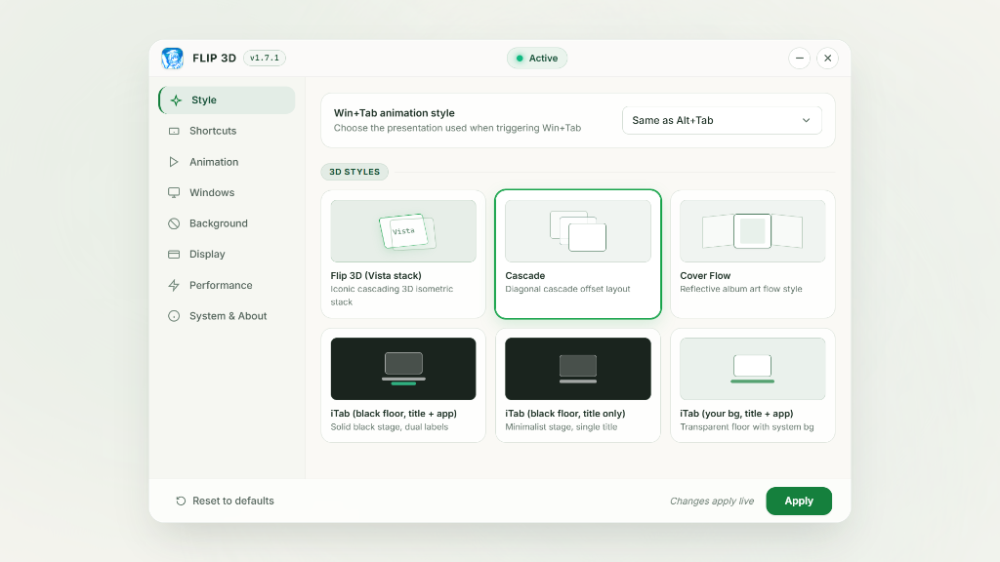
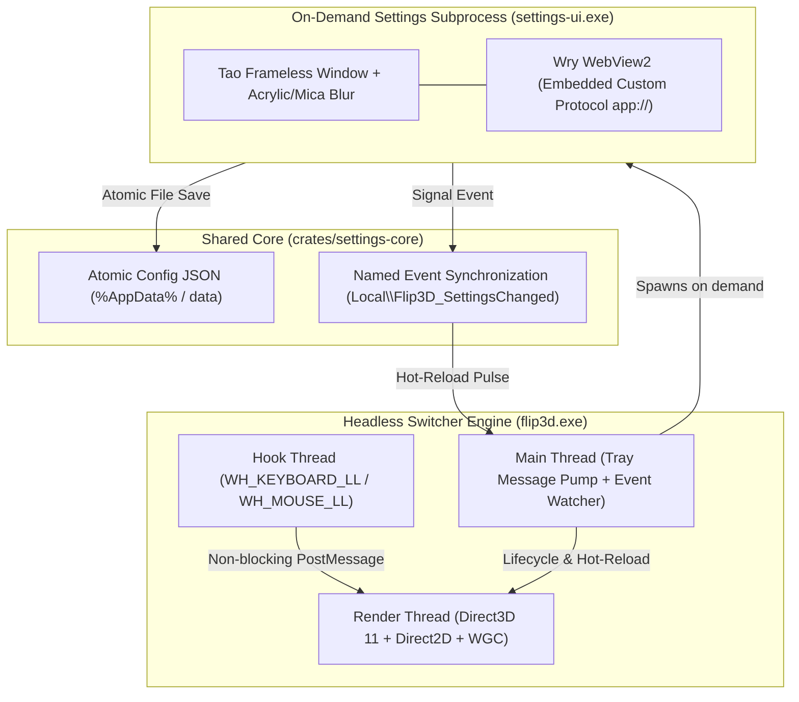

<p align="center">
  
</p>

<h1 align="center">Flip 3D</h1>

<p align="center">
  <strong>The iconic Windows 3D window switcher, reimagined in modern Rust & DirectX 11.</strong>
</p>

<p align="center">
  <a href="https://github.com/VigiRiyantanu/flip3d/releases"></a>
  <a href="https://www.rust-lang.org/"></a>
  <a href="https://www.microsoft.com/windows"></a>
  <a href="https://en.wikipedia.org/wiki/Direct3D_11"></a>
  <a href="LICENSE"></a>
  <a href="https://github.com/VigiRiyantanu/flip3d/actions"></a>
</p>

<p align="center">
  
</p>

---

## Overview

**Flip 3D** brings the fluid, hardware-accelerated 3D window switching experience of Windows Vista and Windows 7 to **Windows 10 and Windows 11**—engineered from the ground up as a standalone, zero-dependency, ultra-low-latency desktop utility written in pure **Rust**, **Direct3D 11**, and **Direct2D**.

Unlike legacy mods, Flip 3D operates entirely in user-space without code injection, without hooking into `explorer.exe`, and without requiring any third-party modding frameworks. It replaces the default `Alt+Tab` (or `Win+Tab`, `Ctrl+Alt+Tab`) with a responsive 3D/2D switcher supporting **24 distinctive layout styles**, sub-millisecond input response, multi-monitor topology, and a native glass settings dashboard.

---

## Key Highlights

<table>
  <tr>
    <td width="50%">
      <h3>⚡ Hardware-Accelerated Performance</h3>
      <p>Direct3D 11 & Direct2D composite pipeline with 3D affine projection matrices, soft drop-shadow shaders, and high-resolution waitable timer frame pacing (<code>CREATE_WAITABLE_TIMER_HIGH_RESOLUTION</code>) synchronized to 120Hz/240Hz+ displays.</p>
    </td>
    <td width="50%">
      <h3>🛡️ Zero Injection & Clean Security</h3>
      <p>Does not inject code into <code>explorer.exe</code> or system processes. Uses non-blocking low-level Windows hooks (<code>WH_KEYBOARD_LL</code>, <code>WH_MOUSE_LL</code>) and the standard <code>Windows.Graphics.Capture</code> (WGC) API with graceful GDI fallback.</p>
    </td>
  </tr>
  <tr>
    <td width="50%">
      <h3>🎨 24 Distinctive Switcher Styles</h3>
      <p>From the faithful recreation of classic <b>Vista Flip 3D</b>, <b>Cascade</b>, and <b>CoverFlow</b> to modern spatial layouts like <b>Helix</b>, <b>Cylinder</b>, <b>Cube</b>, <b>Domino</b>, and <b>Windows 11 Fluent</b>.</p>
    </td>
    <td width="50%">
      <h3>🪟 Real OS Glass Settings Panel</h3>
      <p>Settings panel rendered via isolated on-demand WebView2 with true operating system Acrylic / Mica blur effects (<code>window-vibrancy</code>), 100% offline embedded assets, and instantaneous hot-reloading.</p>
    </td>
  </tr>
  <tr>
    <td width="50%">
      <h3>📦 Portable & Installer Distributions</h3>
      <p>Choose between a self-contained, zero-footprint <b>Portable ZIP</b> (storing everything cleanly under <code>data\</code>) or a streamlined <b>Inno Setup 6 Installer</b> with per-user installation and silent WebView2 runtime deployment.</p>
    </td>
    <td width="50%">
      <h3>🔒 Private, Offline & Telemetry-Free</h3>
      <p>Zero internet requests at runtime, zero telemetry, zero analytics, and statically linked MSVC C runtime (no <code>vcruntime140.dll</code> required). All developer file paths sanitized via path remapping.</p>
    </td>
  </tr>
</table>

---

## Switcher Layout Catalog

Flip 3D includes 24 built-in layout styles plus native pass-through, configurable per shortcut:

| Category | Styles | Description |
| :--- | :--- | :--- |
| **3D Depth Stacks** | `Flip3D`, `Cascade`, `CoverFlow`, `Rolodex`, `Domino` | True projective 3D card stacks with smooth spring physics, infinite scroll wrapping, and depth attenuation. |
| **Spatial 3D Formations**| `Carousel`, `Helix`, `Fan`, `Panorama`, `Tunnel`, `Cube`, `Sphere` | Expansive multi-card geometry mapped in 3D coordinate space with real-time perspective cameras. |
| **Isometric & Floor Reflection**| `ITab`, `ITabTitle`, `ITabBackground`, `ITabBackgroundTitle`, `Shuffle` | Isometric viewing angles with real-time floor reflection shaders, soft ambient glow, and title callouts. |
| **2D & Minimalist Layouts** | `Grid`, `Thumbnails`, `Windows11`, `IconRow`, `List`, `Classic`, `Native` | Modern responsive grids, compact docks, Windows 2000 legacy matrix, or direct system pass-through. |

---

## Installation & Download

Pre-compiled release packages for **Windows 10 (version 1809+, build 17763+)** and **Windows 11 (x64)** are available on the [Releases](https://github.com/VigiRiyantanu/flip3d/releases) page:

### 1. Portable Edition (`.zip`)
Ideal for users who prefer self-contained software without system installation:
- **Zero footprint:** Download `Flip3D-v1.7.1-portable-x64.zip`, extract to any directory, and launch `flip3d.exe`.
- **Isolated Storage:** All configurations and logs are stored locally in the `<exe_dir>\data\` directory.
- **Clean removal:** Delete the folder to completely uninstall.

### 2. Windows Installer (`.exe`)
Ideal for standard desktop installation:
- **Per-User Setup:** Installs to `%LocalAppData%\Programs\Flip 3D` without requiring administrator privileges.
- **System Integration:** Adds Start Menu shortcuts, optional desktop icon, and automated background autostart configuration.
- **Smart Runtime Check:** Automatically verifies Microsoft Edge WebView2 runtime and deploys it silently only if missing.

---

## Controls & Navigation

| Action | Input Combination |
| :--- | :--- |
| **Trigger Switcher** | <kbd>Alt</kbd> + <kbd>Tab</kbd> (or <kbd>Win</kbd> + <kbd>Tab</kbd>, <kbd>Ctrl</kbd> + <kbd>Alt</kbd> + <kbd>Tab</kbd>) |
| **Step Forward / Backward**| Tap <kbd>Tab</kbd> / <kbd>Shift</kbd> + <kbd>Tab</kbd>, or use <kbd>←</kbd> / <kbd>→</kbd> arrow keys |
| **Fast Carousel Scroll** | Mouse Scroll Wheel (<kbd>WheelUp</kbd> / <kbd>WheelDown</kbd>) |
| **Quick-Tap Switch** | Tap and release <kbd>Alt</kbd> + <kbd>Tab</kbd> in under 90ms for instant back-and-forth switching |
| **Close Window** | Middle-click any card or click the hover close button (<kbd>✕</kbd>) |
| **Commit Selection** | Release <kbd>Alt</kbd> (or press <kbd>Enter</kbd> / Left-Click on target card) |
| **Cancel Selection** | Press <kbd>Esc</kbd> |

---

## Technical Architecture

Flip 3D employs a multi-threaded, two-process architecture designed for zero input latency and optimal memory efficiency:



### Engineering Highlights

- **Non-Blocking Hook Architecture**: Low-level hooks (`WH_KEYBOARD_LL`, `WH_MOUSE_LL`) perform zero memory allocations, zero COM invocations, and zero blocking calls. Hook procedures mutate atomic bitmasks and immediately forward input signals to the render thread via asynchronous message queues.
- **The Dummy Virtual Key Trick**: Solves Windows UIPI foreground lockouts. When switching across integrity levels, Flip 3D synthesizes an input packet tagged with `VK_NONAME = 0xE8` and `dwExtraInfo = 0x46334453` (`'FS3D'`), reliably granting permission to call `SetForegroundWindow`.
- **Dual-Process Separation**: The WebView2 settings dashboard runs as an isolated subprocess. When settings are closed, the process terminates immediately, returning 100% of Chromium/WebView2 memory to the operating system while the core engine runs at ~15 MB RAM.
- **Continuous Card Geometry**: Circular layouts render items using dual independent Direct2D effect chains (`Chain[0]` and `Chain[1]`), ensuring seamless visual continuity across stack boundaries during infinite scrolling.

---

## Developer Quickstart

### Prerequisites

- [Rust Toolchain](https://www.rust-lang.org/tools/install) (Rust 1.75+ / 2021 Edition)
- Visual Studio 2022 C++ Build Tools (with Windows 10/11 SDK)
- (Optional) [Inno Setup 6](https://jrsoftware.org/isdl.php) (for compiling installer packages)

### Building from Source

```powershell
# Clone the repository
git clone https://github.com/VigiRiyantanu/flip3d.git
cd flip3d

# Run workspace test suite (19 unit & math tests)
cargo test --workspace

# Run strict clippy analysis
cargo clippy --workspace -- -D warnings

# Build release binaries with LTO and static CRT
cargo build --release --workspace
```

The resulting binaries will be placed in `target/release/`:
- `target/release/flip3d.exe`
- `target/release/settings-ui.exe`

### Automated Release Pipeline

To produce official release artifacts (Portable ZIP, Inno Setup Installer, and SHA-256 checksums):

```powershell
powershell -ExecutionPolicy Bypass -File .\build-release.ps1 -Clean
```

Output directory: `dist/`
- `dist/Flip3D-v1.7.1-portable-x64.zip`
- `dist/Flip3D-Setup-v1.7.1-x64.exe`
- `dist/SHA256SUMS.txt`

---

## Security, Privacy & Integrity

- **Zero Telemetry**: Flip 3D contains no tracking, telemetry, or external network calls.
- **Sanitized Release Artifacts**: Built with `--remap-path-prefix` to ensure no developer machine paths or environment variables are embedded in release binaries.
- **Static CRT Linkage**: Statically linked against the Microsoft C Runtime (`-C target-feature=+crt-static`), eliminating runtime dependencies on external Visual C++ Redistributable DLLs.
- **Single Instance Scoping**: Session-scoped named mutexes (`Local\Flip3D_Engine`, `Local\Flip3D_SettingsUI`) enforce clean single-instance lifecycle without interfering with other Windows user sessions.

---

## 👥 Core Team & Engineering Ownership

Flip 3D is developed and maintained by a dedicated engineering duo, structured with distinct technical domains and module ownership:

| Contributor | Engineering Role | Area of Ownership & Jobdesk |
| :--- | :--- | :--- |
| **Vigi Riyantanu**<br>[@VigiRiyantanu](https://github.com/VigiRiyantanu) | **Lead Systems Architect & Core Graphics Engineer** | • **DirectX 11 Graphics Pipeline**: Direct3D 11 device/swapchain lifecycle, GPU texture staging, and Direct2D/DirectWrite composite overlays.<br>• **3D Projection & Geometry**: Spatial camera matrices, vanishing point transformations, and responsive spring easing math across all 24 layout modes.<br>• **Win32 Kernel & Hooks**: Low-level `WH_KEYBOARD_LL` and `WH_MOUSE_LL` hooks, non-intrusive input interception, and state machine transitions.<br>• **Window Capture & DWM**: Thumbnail acquisition via Windows Graphics Capture & DWM, virtual screen coordinate mapping, and multi-monitor DPI normalization.<br>• **Engine Security & Hardening**: Session-scoped named mutexes, path remapping, and static CRT binary compilation. |
| **jundaee**<br>[@jundaee](https://github.com/jundaee) | **UI/UX Architect & Desktop Systems Engineer** | • **WebView2 Settings Host Runtime**: Tao native windowing host, OS Acrylic and Mica vibrancy integration (`window-vibrancy`), and detached subprocess management (`flip3d.exe --settings`).<br>• **Sandboxing & Custom Protocol**: Offline `app://` custom protocol scheme with embedded asset streaming and strict zero-network sandbox.<br>• **Frontend Glass UI & State Store**: Translucent Ivory & Emerald design system, responsive UI components, custom range sliders, shortcut recorder, and bidirectional IPC bridge.<br>• **System Tray & Lifecycle**: Native tray icon handling, single-instance duplicate alerts, UAC elevation restart routines, and Windows Task Scheduler / Registry autostart.<br>• **Packaging Automation**: Inno Setup 6 installer compilation, WebView2 bootstrapper provisioning, RestartManager hooks, and `build-release.ps1` portable zip packaging. |

### Module Ownership (`.github/CODEOWNERS`)

Code reviews and repository pull requests are automatically mapped based on functional jobdesks:
- **Core Engine & Low-Level Graphics**: [`@VigiRiyantanu`](https://github.com/VigiRiyantanu) (`crates/engine/src/{gfx,geometry,layout,render,capture,hooks,switcher}`)
- **Settings UI, Tray, Autostart & Packaging**: [`@jundaee`](https://github.com/jundaee) (`crates/settings-ui/`, `crates/engine/src/app/`, `installer/`, `build-release.ps1`)
- **Shared Core Configuration & Protocols**: [`@VigiRiyantanu`](https://github.com/VigiRiyantanu) & [`@jundaee`](https://github.com/jundaee) (`crates/settings-core/`)

### Acknowledgements

Flip 3D is a faithful standalone Rust port based on the original [Alt+Tab Flip 3D (Vista Style)](https://windhawk.net/mods/alt-tab-flip-3d) mod for Windhawk by **caliberda** ([alt-tab-flip-3d-fork](https://github.com/cesarkali/alt-tab-flip-3d-fork)), distributed under the MIT License.

---

## License

This project is licensed under the **MIT License** — see the [LICENSE](LICENSE) file for complete details.
