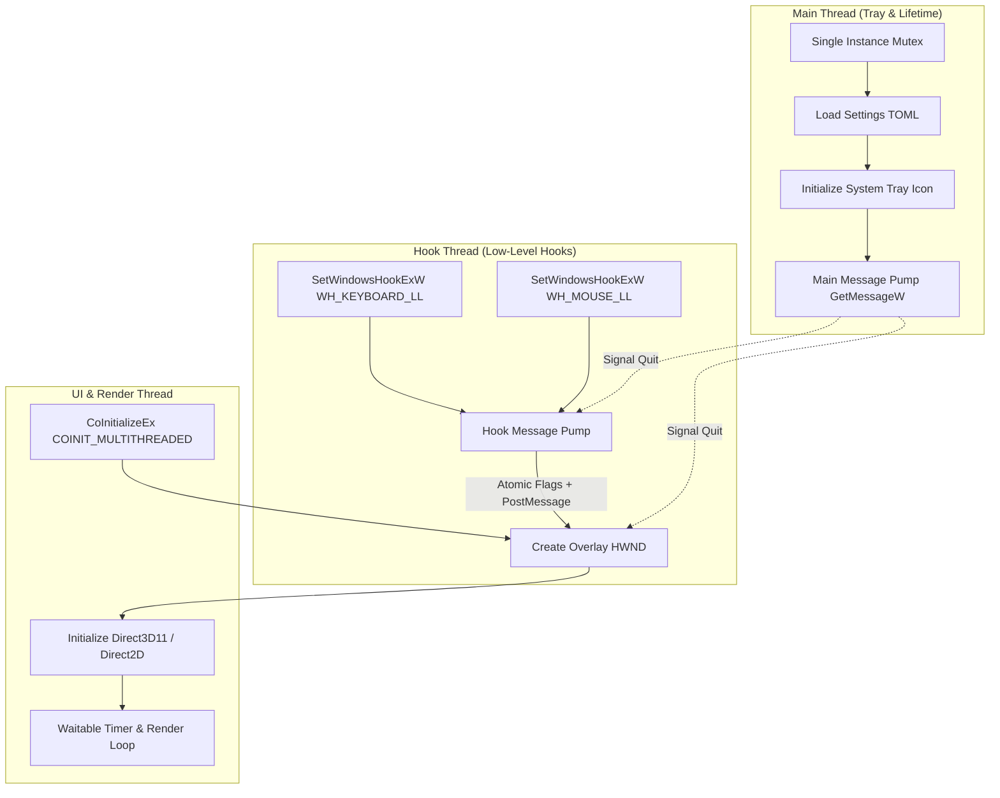
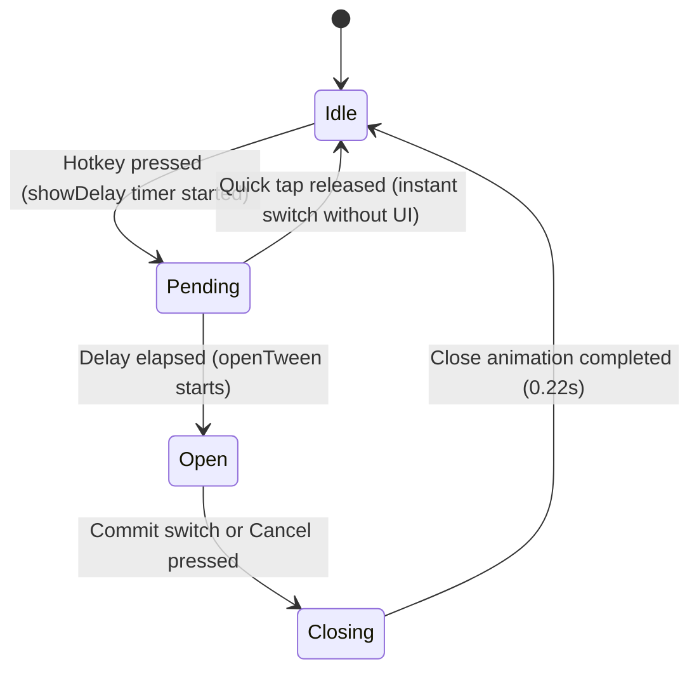
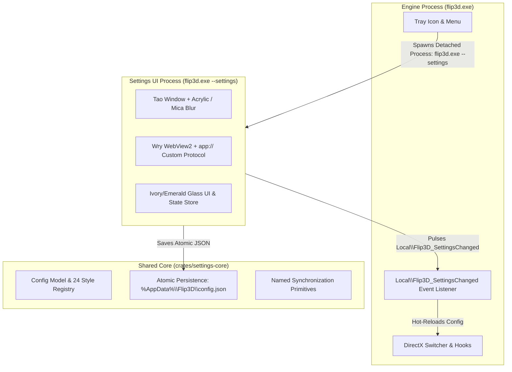
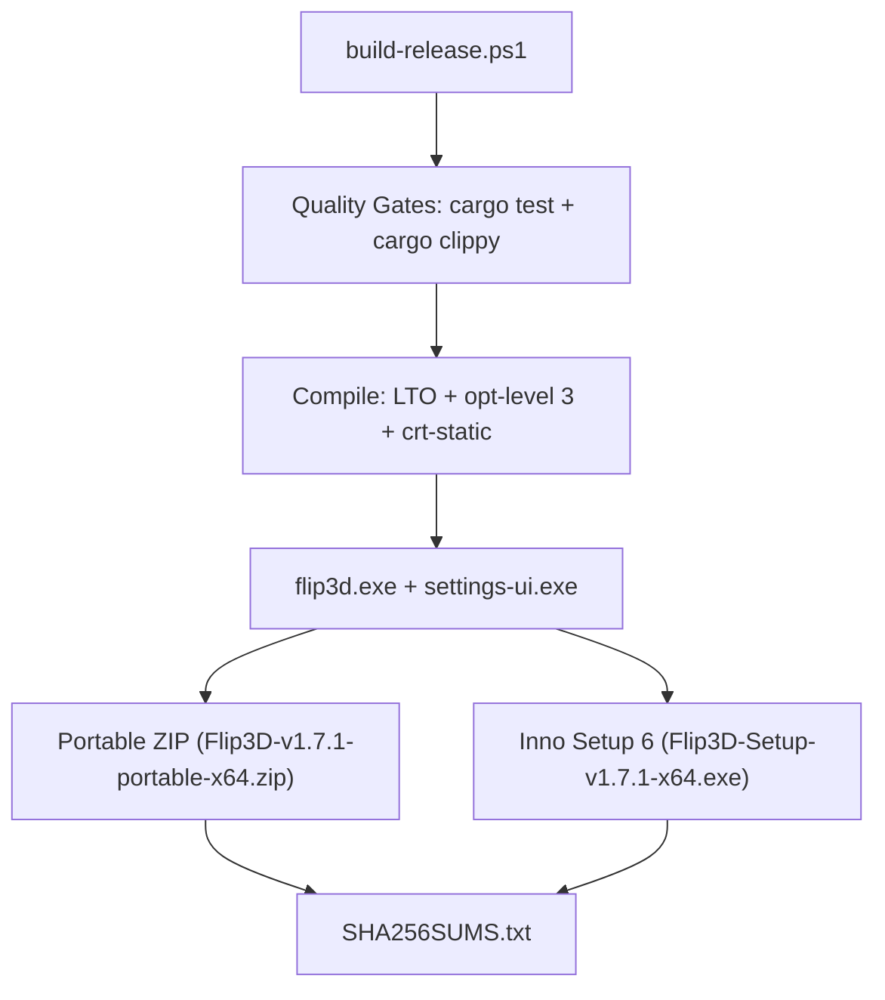

# Architecture & Design of Flip 3D (Rust)

This document describes the multi-threaded architecture, graphics pipeline, state machine, and data flow of the standalone Rust implementation of Flip 3D.

---

## 1. Multi-Threaded Architecture

Flip 3D operates with three distinct threads to guarantee zero input latency, smooth high-framerate rendering, and responsive desktop integration:



### 1.1 The Main Thread (`src/main.rs`)
- Checks single-instance mutex scoped to the logon session (`Local\Flip3D_SingleInstance_{sessionId}`).
- Initializes the file logger (`%APPDATA%\Flip3D\flip3d.log`).
- Manages the notification tray icon (`Shell_NotifyIconW`) and context menu (Settings, Pause, Run as admin, Start with Windows, About, Exit).
- Spawns the dedicated Hook Thread and UI Thread.
- Listens for tray events and coordinates clean shutdown on exit.

### 1.2 The Hook Thread (`src/hooks.rs`)
- Installs `WH_KEYBOARD_LL` and `WH_MOUSE_LL` hooks.
- **Rule of Non-Blocking**: Hook callbacks (`keyboard_proc`, `mouse_proc`) execute zero COM calls, zero allocations, and zero blocking operations. They mutate lockless atomics (`G_PHYSICAL_KEYS`, `G_SWITCHING`) and asynchronously post messages (`PostMessageW` / `PostThreadMessageW`) to the overlay window.
- Traps all Rust panics inside `catch_unwind` and always falls through to `CallNextHookEx`.

### 1.3 The UI / Render Thread (`src/switcher.rs`)
- Owns the topmost, borderless, click-through overlay window (`CreateWindowExW(WS_EX_TOOLWINDOW | WS_EX_TOPMOST | WS_EX_NOREDIRECTIONBITMAP)`).
- Initializes DirectX 11, DXGI Swapchain, Direct2D Device Context, and DirectWrite Factory.
- Implements the state machine (`Idle`, `Pending`, `Open`, `Closing`).
- Runs frame pacing using `CREATE_WAITABLE_TIMER_HIGH_RESOLUTION` synchronized to the display refresh rate.

---

## 2. Graphics & Capture Pipeline


### 2.1 Window Capture Abstraction (`src/capture.rs`)
- **Windows Graphics Capture (WGC)**: Creates a WinRT `GraphicsCaptureItem` for each switchable window using `IGraphicsCaptureItemInterop`. Captures live frames at native window refresh rates into Direct3D 11 textures.
- **PrintWindow Fallback**: If WGC fails (permissions, elevated window, or older OS build), takes a high-quality GDI snapshot via `PrintWindow(hwnd, hdc, PW_RENDERFULLCONTENT)` and uploads it into a D3D11 texture.

### 2.2 Direct2D 3D Effect Chains (`src/render.rs`)
- Every window card possesses dual effect chains:
  - `CLSID_D2D13DTransform`: Projects 2D rectangular textures onto 3D quadrilateral coordinates calculated by `layout_pose` and `project_pose`.
  - `CLSID_D2D1ColorMatrix`: Applies dynamic depth shading, brightness attenuation, and smooth opacity transitions.
  - `CLSID_D2D1Shadow`: Computes real-time soft drop shadows beneath active cards.

---

## 3. State Machine



1. **Idle**: Overlay window is hidden (`SWP_HIDEWINDOW`). Zero GPU redraw cost.
2. **Pending**: User tapped Alt+Tab. The switcher queries window lists and starts capture. If released in under `showDelay` (default 90ms), it instantly activates the next window without showing the overlay.
3. **Open**: Overlay is shown topmost. Physics spring calculations (`omega = 15.0 * flipSpeed`, `kStep = 1.0/480`) continuously interpolate scroll position and 3D camera pose.
4. **Closing**: Smoothly animates cards out over `kCloseAnimationSeconds` (0.22s) using `ease_out_quart`. Restores the target window and returns to `Idle`.

---

## 4. 2-Process Architecture & Settings UI



### 4.1 Single Executable Architecture (Self-Re-Executing 2-Process Model)
- **Single Portable Executable (`flip3d.exe`)**: All engine code, system tray management, low-level hooks, and the full WebView2 settings panel (with embedded HTML/CSS/JS/fonts/manifest) are compiled into one single standalone binary `flip3d.exe` (~1.99 MB).
- **Default Execution (No Args)**: Runs the headless background engine with the system tray icon and Direct3D/Direct2D overlay.
- **Settings Subprocess (`flip3d.exe --settings`)**: When the user clicks "Settings" in the tray (or invokes `--settings` manually), the engine spawns a detached instance of itself: `flip3d.exe --settings`. This launches the WebView2 panel in an isolated process. When the settings window is closed, the subprocess terminates, immediately reclaiming all WebView2 memory while the engine remains lean and lightweight.

### 4.2 Shared Persistence & IPC
- Configuration is stored at `%AppData%\Flip3D\config.json` with automatic migration from legacy `config.toml` (renamed to `config.toml.migrated`).
- All file writes are atomic: written to a unique `.tmp` file in the same directory, flushed, and renamed.
- Changes apply live: saving immediately pulses `Local\Flip3D_SettingsChanged`, signaling the engine to re-read and apply changes with zero latency.
- Bidirectional JSON IPC connects the frontend to the Rust host:
  - Request: `{ id: string, type: string, payload?: any }` via `window.ipc.postMessage(...)`.
  - Response: `window.__app.receive({ id, ok, payload, error })`.
  - Push events: `window.__app.push({ event, data })`.

---

## 5. Distribution Modes & Packaging Architecture

Flip 3D supports two first-class distribution forms built from the exact same codebase via a unified release script:



### 5.1 Single Source of Truth for Paths (`AppPaths`)
Paths are dynamically resolved by `settings_core::AppPaths::resolve()`, shared identically across the engine and settings UI:

1. **Detection Precedence**:
   - `FLIP3D_PORTABLE=1` (or `"true"`) environment variable OR `--portable` CLI argument -> **Portable Mode**.
   - `flip3d.portable` marker file next to `current_exe()` -> **Portable Mode**.
   - Default -> **Installed Mode**.

2. **Storage Resolution**:
   - **Installed Mode**:
     - Config: `%AppData%\Flip3D\config.json`
     - Logs: `%LocalAppData%\Flip3D\logs\`
     - WebView2 Data: `%LocalAppData%\Flip3D\webview2\`
   - **Portable Mode**:
     - All data under `<exe_dir>\data\` (`config.json`, `logs\`, `webview2\`).
     - Probes writability at launch (`AppPaths::probe_writability`). If unwritable (read-only media or Program Files), logs a warning and falls back to Installed user profile paths without crashing.
     - Moving the portable folder quietly repairs any existing `HKCU\Software\Microsoft\Windows\CurrentVersion\Run` entry on launch.

3. **UI Indication**:
   - The settings panel "System & About" tab displays a live badge:
     `Distribution: Portable` (with tooltip showing data directory) or `Distribution: Installed`.

### 5.2 Release Automation (`build-release.ps1`)
The entire release pipeline is driven by `build-release.ps1`:
```powershell
powershell -ExecutionPolicy Bypass -File .\build-release.ps1 [-Target <triple>] [-Version <v>] [-Clean] [-Sign]
```
- **Static CRT Linkage**: Statically links the C runtime on `x86_64-pc-windows-msvc` (`-C target-feature=+crt-static`) configured in `.cargo/config.toml`, ensuring zero dependency on `vcruntime140.dll` or `msvcp140.dll`.
- **PE Metadata & Manifests**: Embeds multi-size icons, product version (1.7.1), copyright, and PerMonitorV2 manifest into both executables.
- **Inno Setup 6 Packaging**: Compiles the modern installer with RestartManager, silent WebView2 deployment, and uninstaller configuration retention.
- **Checksums**: Automatically outputs GNU `sha256sum`-compatible `dist/SHA256SUMS.txt`.

